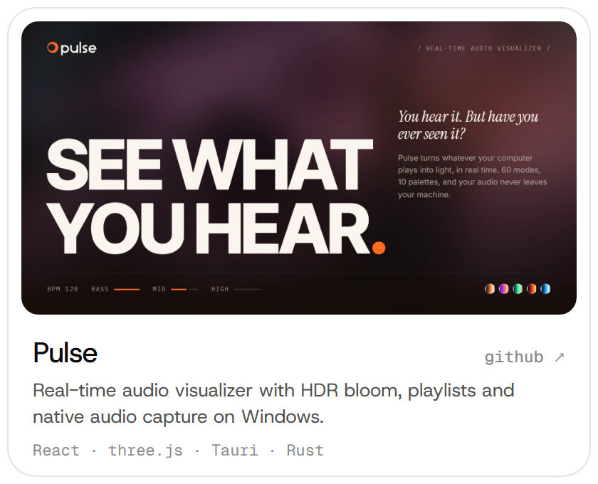
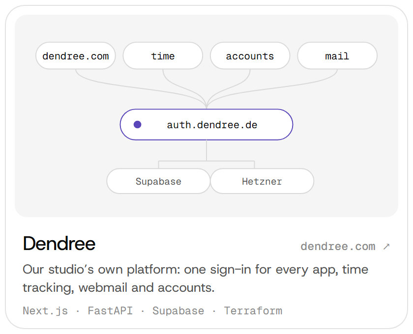
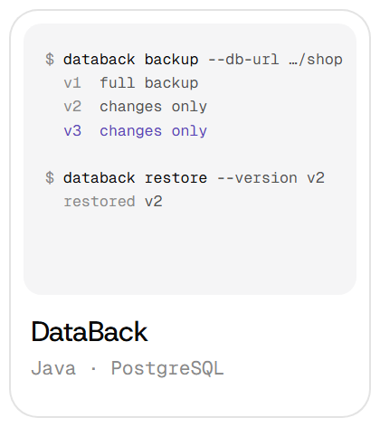
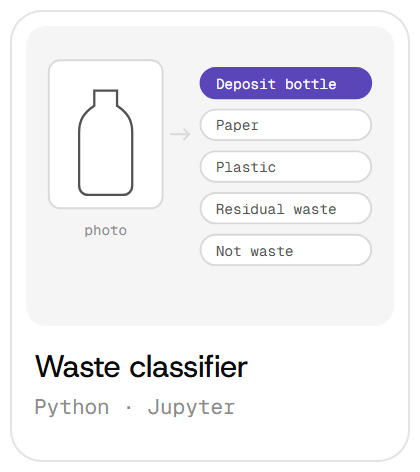
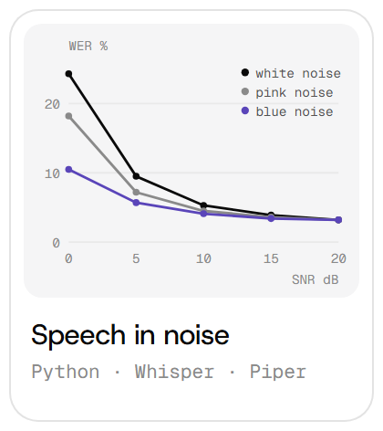
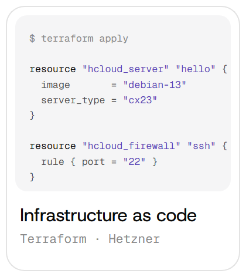

<picture>
  <source media="(prefers-color-scheme: dark)" srcset=".github/assets/banner-dark.png">
  <source media="(prefers-color-scheme: light)" srcset=".github/assets/banner-light.png">
  
</picture>

 
 

I build web applications from the interface down to the server they run on. With two co-founders I run [Dendree](https://dendree.com), a studio in Stuttgart that builds web platforms, apps and AI tools for companies. Alongside that I work on a web application at Mercedes-Benz and study Media Informatics at Stuttgart Media University (HdM).

### Selected work

<a href="https://github.com/byGamsa/pulse-audio-visualizer"><picture><source media="(prefers-color-scheme: dark)" srcset=".github/assets/tiles/pulse-dark.png"></picture></a><a href="https://dendree.com"><picture><source media="(prefers-color-scheme: dark)" srcset=".github/assets/tiles/dendree-dark.png"></picture></a><a href="https://github.com/byGamsa/DataBack"><picture><source media="(prefers-color-scheme: dark)" srcset=".github/assets/tiles/databack-dark.png"></picture></a><a href="https://github.com/byGamsa/slt-ai"><picture><source media="(prefers-color-scheme: dark)" srcset=".github/assets/tiles/waste-dark.png"></picture></a><a href="https://github.com/byGamsa/speech-interaction-ai"><picture><source media="(prefers-color-scheme: dark)" srcset=".github/assets/tiles/speech-dark.png"></picture></a><a href="https://github.com/byGamsa/sdi"><picture><source media="(prefers-color-scheme: dark)" srcset=".github/assets/tiles/sdi-dark.png"></picture></a>

More on [my profile](https://github.com/byGamsa?tab=repositories). Most of my client and Dendree work lives in private repositories.

### Stack

- **Languages** &nbsp; `TypeScript` `JavaScript` `Python` `Java` `C#`
- **Frontend** &nbsp; `React` `Next.js` `Vue` `Nuxt` `Angular` `three.js`
- **Backend** &nbsp; `FastAPI` `Node.js`
- **Data** &nbsp; `PostgreSQL` `Supabase` `MongoDB`
- **Infrastructure** &nbsp; `Docker` `Terraform` `GitHub Actions`
- **Other** &nbsp; `Unity` `Tauri`

### Activity

<picture>
  <source media="(prefers-color-scheme: dark)" srcset="https://streak-stats.demolab.com?user=byGamsa&locale=en&mode=daily&border_radius=18&background=0A0A0A&border=2A2A2A&stroke=262626&ring=9388EC&fire=9388EC&currStreakNum=F3F3F3&sideNums=F3F3F3&currStreakLabel=9388EC&sideLabels=AAAAAA&dates=767676&date_format=M%20j%5B%2C%20Y%5D">
  <source media="(prefers-color-scheme: light)" srcset="https://streak-stats.demolab.com?user=byGamsa&locale=en&mode=daily&border_radius=18&background=FFFFFF&border=E3E3E3&stroke=E9E9E9&ring=5A45B9&fire=5A45B9&currStreakNum=0A0A0A&sideNums=0A0A0A&currStreakLabel=5A45B9&sideLabels=525252&dates=858585&date_format=M%20j%5B%2C%20Y%5D">
  
</picture>

### Contact

[larsgerigk.de](https://larsgerigk.de) &nbsp;·&nbsp; [LinkedIn](https://www.linkedin.com/in/lars-gerigk/) &nbsp;·&nbsp; [dendree.com](https://dendree.com)
